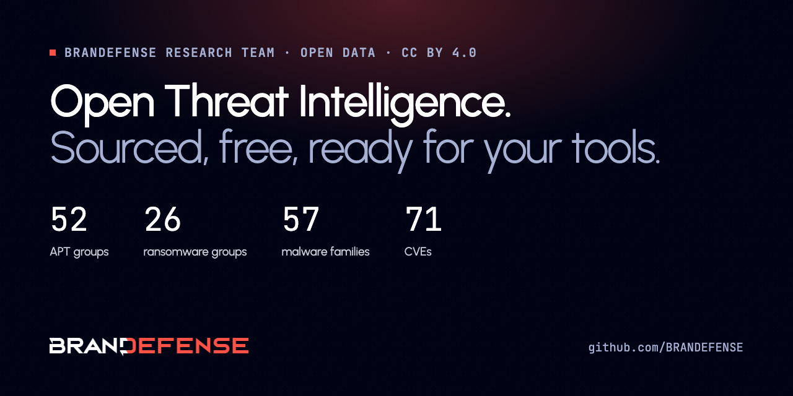

## Brandefense

AI-driven threat intelligence platform that unifies Cyber Threat Intelligence, Digital Risk Protection and External Attack Surface Management. [brandefense.io](https://brandefense.io)

### Open threat intelligence

| Repository | What it holds |
|---|---|
| [threat-actor-dataset](https://github.com/BRANDEFENSE/threat-actor-dataset) | 52 APT groups, 26 ransomware groups, 57 malware families, 41 MITRE ATT&CK techniques. JSON, CSV, STIX 2.1 |
| [exploited-vulnerabilities-dataset](https://github.com/BRANDEFENSE/exploited-vulnerabilities-dataset) | 71 exploited or high-severity CVEs with CVSS and CISA KEV status. JSON, CSV, STIX 2.1 |
| [IoC](https://github.com/BRANDEFENSE/IoC) | Indicators of compromise and YARA rules from our research |
| [Threat-Intelligence-Researches](https://github.com/BRANDEFENSE/Threat-Intelligence-Researches) | Threat research reports (PDF) |

Both datasets are free to use under CC BY 4.0.

### More

- [Knowledge Hub](https://brandefense.io/knowledge-hub/): threat actor, malware and vulnerability profiles
- [ATLAS](https://atlas.brandefense.io): free threat intelligence tools, no signup
- Brandefense in [Claude](https://claude.ai/directory/mcp-brandefense-io) and [ChatGPT](https://chatgpt.com/plugins/plugin_asdk_app_6aac13cdfb5c8191b4bdab7c39453659)
- [LinkedIn](https://www.linkedin.com/company/brandefense) · [X](https://x.com/brandefense) · info@brandefense.io
